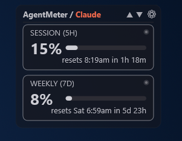
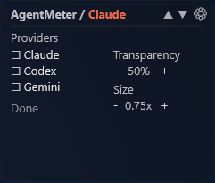
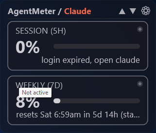
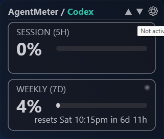
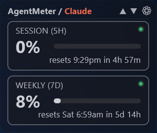

# AgentMeter

A Rainmeter desktop widget that shows subscription quota usage for Claude,
Codex and Gemini (Antigravity CLI): session (5h) and weekly (7d) usage, time
until reset, and whether each CLI is currently running.

No daemon: the skin runs a small Go executable every 60 seconds. It reads
each CLI's own local login, writes a flat `data.json`, and exits. If the
skin is not loaded, nothing runs.

## Screenshots

<p align="center">
  <br>
  
  
</p>
<p align="center">
  
  
  
</p>

## Requirements

| What | Needed for | Notes |
|---|---|---|
| Windows 10/11 | everything | Uses the Windows process list and Credential Manager. |
| [Go](https://go.dev/dl/) 1.26+ | building `agentmeter.exe` | **Optional to install**: if `go` is not on `PATH`, `build.ps1` downloads the official zip into `.\go`. |
| PowerShell 7 (`pwsh`) or Windows PowerShell | running `build.ps1` | Both work. |
| [Rainmeter](https://www.rainmeter.net/) 4.5+ | showing the widget | **Optional to install**: `build.ps1 -Portable` downloads a portable copy into the project. |

Plus a login in each CLI you want tracked. Untracked or logged-out providers
simply show an error message on their cards; the others keep working.

| Provider | Log in with | Where AgentMeter reads it |
|---|---|---|
| Claude | Claude Code (`claude`) | `%USERPROFILE%\.claude\.credentials.json` |
| Codex | Codex CLI (`codex`) | `%USERPROFILE%\.codex\sessions\...\rollout-*.jsonl` |
| Gemini | Antigravity CLI (`agy`) | Windows Credential Manager, target `gemini:antigravity` |

## Install

Quickest, no Go needed: download `AgentMeter-<version>.zip` from
[Releases](https://github.com/fabianramirez-code/AgentMeter/releases), extract
the `AgentMeter` folder into `%USERPROFILE%\Documents\Rainmeter\Skins\`, then
in Rainmeter: **Refresh all**, **Manage**, `AgentMeter\AgentMeter.ini`,
**Load**. The bundled `agentmeter.exe` is not code-signed, so Windows
SmartScreen or your antivirus may ask before the first run.

To build from source instead:

Option A, you already have Rainmeter installed:

```powershell
.\build.ps1
```

Then in Rainmeter: right-click the tray icon, **Manage**, select
`AgentMeter\AgentMeter.ini`, **Load**.

Option B, nothing installed (no Go, no Rainmeter):

```powershell
.\build.ps1 -Portable
```

On the first run this downloads the official Rainmeter installer from
GitHub releases, checks its signature, and installs it in portable mode into
`.\rainmeter` (git-ignored; no registry or Start menu changes). It then
installs the skin there and launches it. Later, start it with
`.\rainmeter\Rainmeter.exe`.

Both options use Go from `PATH` if present. Otherwise, on the first run they
download the latest official Go zip from go.dev, verify its SHA256 checksum,
and extract it into `.\go` (git-ignored; no installer, no admin rights, no
system `PATH` change). Then they run `go test ./...` and build
`agentmeter.exe`. Re-running
`build.ps1` updates the skin and resets its saved settings to the defaults.

## Using the widget

- **▲ / ▼** switch between enabled providers. The choice is remembered.
- **⚙** opens settings: enable/disable providers, transparency (0-100 %),
  size (0.75x-2x). The panel stays open until you click **Done**.
- **Card color** is a usage traffic light: gray-white below 60 %, yellow from
  60 %, red from 85 %. Change `WarnPct` / `CritPct` in `AgentMeter.ini`.
- **Dot**: green while that provider's CLI process is running, gray
  otherwise. Hover it for "Active" / "Not active".
- Process names are configurable in `AgentMeter.ini` (`ProcClaude`,
  `ProcCodex`, `ProcGemini`).

## Network usage

Codex is read from a local file. Claude and Gemini need one HTTPS request
each, and these requests do **not** consume model tokens (they read account
metadata, like the CLIs' own `/usage` command). To stay well below the
endpoints' rate limits, a provider is polled only when:

- it has never been fetched, or
- its CLI is running **and** its local logs changed since the last fetch, or
- the last fetch is older than 20 minutes (catches web/mobile usage),

and never more than once every 5 minutes, even after a failed attempt.
Countdowns ("resets in 2h 14m") are recomputed locally every run.

## Sharing and credentials

No credentials live in this repository, in the built executable, or in
`data.json` / `state.json`. At runtime `agentmeter.exe` reads tokens from the
current user's own CLI login and never stores, logs, or refreshes them.
Sharing the repo shares code only; each person sees their own usage.

## Why might a provider show "error" or "stale"?

Each provider fails independently.

- **Claude** uses the undocumented `GET https://api.anthropic.com/api/oauth/usage`
  endpoint. If Anthropic changes its URL, headers, or `five_hour`/`seven_day`
  response shape, Claude shows `error`.
- **Codex** reads `payload.rate_limits` from the newest session file. If the
  Codex CLI changes that schema, Codex shows `error`.
- **Gemini** reads the Antigravity token from Credential Manager and calls the
  undocumented `fetchAvailableModels` endpoint on
  `daily-cloudcode-pa.googleapis.com`, sending `User-Agent: antigravity-cli`
  (without it the server answers 403). Changes to the credential layout,
  endpoint, header check, or `quotaInfo` shape show `error`.
- **stale / "login expired"**: the CLI's token expired. AgentMeter never
  refreshes tokens itself (that could race the CLI's own rotation). Open that
  CLI once and the data comes back on the next poll. Antigravity only
  refreshes its token while `agy` is running.
- **"request failed"** after many reloads: likely HTTP 429 from the endpoint;
  it recovers on its own after the 5-minute minimum interval.

Every one of these call sites has a `NOTE:` comment in the source
(`claude.go`, `codex.go`, `gemini.go`) saying what to check first.

## Project layout

```
main.go, claude.go, codex.go, gemini.go   collector (one file per provider)
pollgate.go, state.go, format.go, win.go  polling rules, cache, reset text, Windows APIs
*_test.go                                 go test ./...
skin/AgentMeter/AgentMeter.ini            Rainmeter skin (UTF-8 here, UTF-16 when installed)
skin/AgentMeter/@Resources/Scripts/       provider cycling and settings panel (Lua)
build.ps1                                 test, build, install (optionally portable)
go/, rainmeter/                           local toolchains downloaded by build.ps1 (git-ignored)
docs/design.md                            design notes
```

## License

AgentMeter is MIT licensed (see `LICENSE`). Rainmeter is GPL v2 and is
downloaded from its official releases, not
redistributed in this repository.
